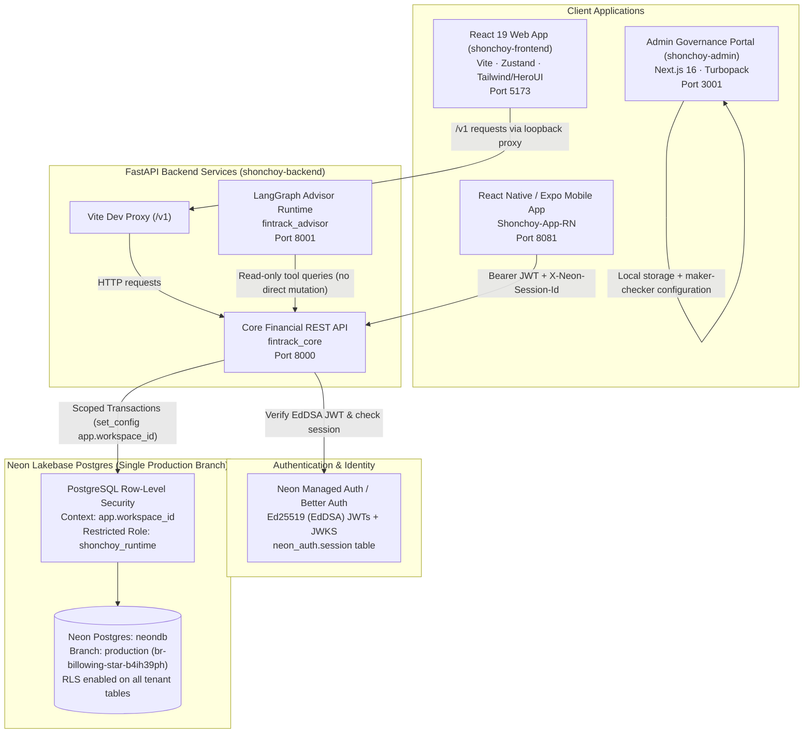
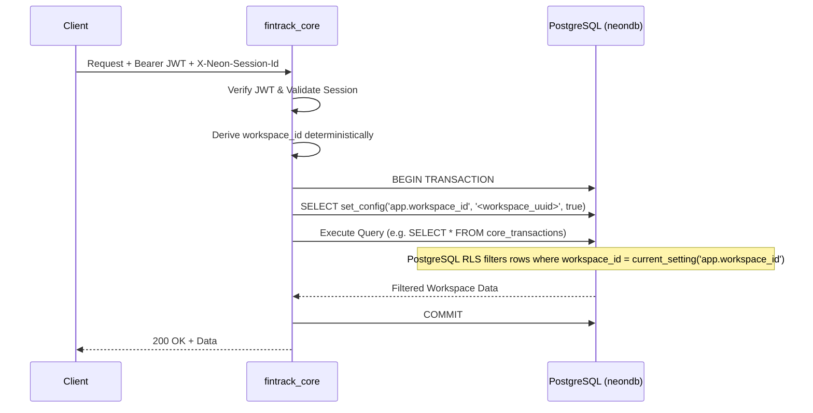
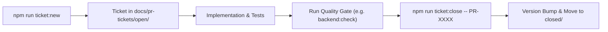

# Shonchoy (Project FinTrack): Workspace Setup & Comprehensive Architecture Guide

> **Authoritative Engineering Guide for Developers & AI Agents**  
> This document is the canonical reference for setting up, understanding, and extending the Shonchoy monorepo. Every developer and AI agent working on this repository **must read and adhere to** the architectural patterns, security invariants, and coding protocols defined below.

---

## Table of Contents

1. [Executive Overview & System Topology](#1-executive-overview--system-topology)
2. [Prerequisites & Development Environment](#2-prerequisites--development-environment)
3. [Step-by-Step Workspace Setup from Scratch (Post-Clone)](#3-step-by-step-workspace-setup-from-scratch-post-clone)
4. [Comprehensive System Architecture](#4-comprehensive-system-architecture)
   - [Monorepo Structure & Mirror Topology](#41-monorepo-structure--mirror-topology)
   - [Frontend Architecture (`shonchoy-frontend`)](#42-frontend-architecture-shonchoy-frontend)
   - [Backend Core API (`fintrack_core`)](#43-backend-core-api-fintrack_core)
   - [Intelligent Advisor Runtime (`fintrack_advisor`)](#44-intelligent-advisor-runtime-fintrack_advisor)
   - [Admin Control Plane (`shonchoy-admin`)](#45-admin-control-plane-shonchoy-admin)
   - [Database & Multi-Tenant Security (Neon Postgres + RLS)](#46-database--multi-tenant-security-neon-postgres--rls)
   - [Authentication & Identity Flow (Neon Auth / JWT / Sessions)](#47-authentication--identity-flow-neon-auth--jwt--sessions)
5. [Core Financial & Engineering Invariants (Non-Negotiable)](#5-core-financial--engineering-invariants-non-negotiable)
6. [How to Write New Code Following the Architecture](#6-how-to-write-new-code-following-the-architecture)
   - [Recipe A: Adding a New Backend REST Endpoint](#recipe-a-adding-a-new-backend-rest-endpoint)
   - [Recipe B: Adding Database Migrations with Alembic](#recipe-b-adding-database-migrations-with-alembic)
   - [Recipe C: Adding a New Frontend Feature or Screen](#recipe-c-adding-a-new-frontend-feature-or-screen)
   - [Recipe D: Extending the Admin Control Plane](#recipe-d-extending-the-admin-control-plane)
   - [Recipe E: Adding AI Advisor Capabilities](#recipe-e-adding-ai-advisor-capabilities)
7. [Testing & Verification Protocols](#7-testing--verification-protocols)
8. [The Local PR Ticket & Release Lifecycle](#8-the-local-pr-ticket--release-lifecycle)
9. [Troubleshooting & Frequently Encountered Issues](#9-troubleshooting--frequently-encountered-issues)
10. [Command Cheatsheet](#10-command-cheatsheet)

---

## 1. Executive Overview & System Topology

**Shonchoy** (Project FinTrack) is an intelligent personal finance management, conversational advisory, and administrative governance platform built for Bangladesh and international multi-currency workflows. It natively handles Bangladeshi financial primitives (BDT Taka currency, 9-digit Bangladesh Bank routing codes, bKash/Nagad fee structures, SMS transaction scraping) alongside global multi-currency ledgers.

### High-Level Architectural Diagram



---

## 2. Prerequisites & Development Environment

Before setting up the repository, ensure your environment meets these exact requirements:

| Tool | Required Version | Verification Command | Notes |
| :--- | :--- | :--- | :--- |
| **Node.js** | `>= 22.22.0` | `node -v` | Required across the workspace root, frontend, and admin. |
| **npm** | `>= 10.0.0` | `npm -v` | Standard package manager for JavaScript dependencies. |
| **Python** | `>= 3.12.0` | `python --version` | Required for backend services (`shonchoy-backend`). |
| **uv** | Latest (`>= 0.5.0`) | `uv --version` | Fast Python package and project manager. **Mandatory** for virtual environment and lockfile integrity. |
| **Git** | `>= 2.40.0` | `git --version` | Required for version control and submodule/worktree management. |
| **PostgreSQL client (psql)** | `>= 15.0` (optional) | `psql --version` | Useful for direct database inspection and running SQL setup scripts. |

> [!NOTE]
> On Windows, commands in this repository work seamlessly in **PowerShell**. The tooling scripts (`run-all.mjs`, `stop-all.mjs`, `backend-quality.mjs`) are fully cross-platform and resolve platform-specific virtual environment paths (e.g., `.venv/Scripts/python.exe` on Windows vs `.venv/bin/python` on POSIX).

---

## 3. Step-by-Step Workspace Setup from Scratch (Post-Clone)

Follow this precise sequence whenever you clone the repository or set up a clean workspace:

### Step 1: Clone the Authoritative Repository
```bash
git clone https://github.com/KamrulIslamArnob/Shonchoy---Dev.git
cd Shonchoy---Dev
```

### Step 2: Install Monorepo Root Dependencies
From the repository root:
```bash
npm install
```
This installs root tooling for ticket management, security scans, quality gates, and process orchestration.

### Step 3: Set Up the Python Virtual Environment for Backend
Navigate to `shonchoy-backend` and use `uv` to create the virtual environment and install dependencies strictly from `uv.lock`:
```bash
cd shonchoy-backend
uv sync --locked
```
This creates `.venv/` containing FastAPI, SQLAlchemy 2.0, Alembic, LangGraph, Ruff, mypy, and test dependencies.
Return to root:
```bash
cd ..
```

### Step 4: Install Frontend & Admin Dependencies
From the repository root:
```bash
# Install frontend client dependencies
npm --prefix shonchoy-frontend install

# Install admin control plane dependencies
npm --prefix shonchoy-admin install
```

### Step 5: Configure Environment Files
Never commit real credentials or private connection strings to Git. Copy the provided `.env.example` templates:

#### 1. Backend Configuration (`shonchoy-backend/.env`)
Copy `shonchoy-backend/.env.example` to `shonchoy-backend/.env`:
```bash
# In shonchoy-backend/
cp .env.example .env
```
Populate the variables:
```ini
# Generate a private random 32+ character key for command fingerprints:
FINTRACK_COMMAND_FINGERPRINT_KEY=replace-with-a-random-secret-key-at-least-32-chars-long

# Exact Neon Auth endpoint configured in the project:
FINTRACK_NEON_AUTH_URL=https://your-branch.neonauth.region.aws.neon.tech/neondb/auth

# Keep false for production-like tenant scoping:
FINTRACK_ENABLE_DEVELOPMENT_ROUTES=false

# Neon pooled runtime URL using the restricted 'shonchoy_runtime' role:
# Format: postgresql+psycopg://shonchoy_runtime:<PASSWORD>@<HOST>-pooler.region.aws.neon.tech/neondb?sslmode=require
FINTRACK_DATABASE_URL=

# Neon direct (non-pooler) URL using the database owner for Alembic migrations:
# Format: postgresql+psycopg://neondb_owner:<PASSWORD>@<HOST>.region.aws.neon.tech/neondb?sslmode=require
FINTRACK_MIGRATION_DATABASE_URL=

# Allowed browser origins (JSON string):
FINTRACK_CORS_ORIGINS=["http://localhost:5173","http://127.0.0.1:5173","http://localhost:8081","http://localhost:3000","http://localhost:3001"]
```

#### 2. Frontend Configuration (`shonchoy-frontend/.env`)
Create `shonchoy-frontend/.env`:
```ini
# Leave unset or empty for connected mode (API via loopback proxy to port 8000).
# Set to 'demo' ONLY if you want pure browser-local mock storage without backend.
VITE_DATA_MODE=
```

#### 3. Admin Configuration (`shonchoy-admin/.env.local`)
Create `shonchoy-admin/.env.local`:
```ini
ADMIN_SESSION_SECRET=replace-with-a-random-secret-for-admin-sessions-32-chars
# Optional: Brandfetch API key for fetching institution logos
BRANDFETCH_API_KEY=
```

### Step 6: Database Setup & Single Production Branch Rule
> [!IMPORTANT]
> **Database Rule**: Project `FinTrack_DB` (`winter-surf-88756036`), database `neondb` uses **exactly one branch**: `production` (`br-billowing-star-b4ih39ph`).
> Do **NOT** create development, preview, or staging branches on Neon. Both authentication and financial data reside on this single production branch.

1. **Configure the Restricted Runtime Role**:  
   Run `shonchoy-backend/scripts/configure_private_runtime.sql` as database owner in Neon SQL Editor or via `psql`. This script creates the `shonchoy_runtime` role with row-level security enforcement and grants read access to `neon_auth.session`.
   Set the role password privately:
   ```sql
   ALTER ROLE shonchoy_runtime WITH PASSWORD 'your-private-runtime-password';
   ```
2. **Apply Database Migrations**:  
   From the repository root:
   ```bash
   npm run backend:migrate
   ```
   Or inside `shonchoy-backend`:
   ```bash
   uv run alembic upgrade head
   ```

### Step 7: Launch All Development Services
You can run all services orchestrated together:
```bash
npm run dev:all
```
This concurrently boots:
- **Frontend Client**: `http://localhost:5173`
- **Core Financial API**: `http://localhost:8000`
- **LangGraph Advisor API**: `http://localhost:8001`
- **Admin Portal**: `http://localhost:3001`

To stop all orchestrated background services:
```bash
npm run stop:all
```

Alternatively, run individual services in separate terminals:
- `npm run frontend:dev`
- `npm run backend:dev`
- `npm run advisor:dev`
- `npm run admin:dev`

### Step 8: Verify System Health
Check core API liveness:
```bash
curl http://localhost:8000/health
# Expected: {"status":"ok","database":"disabled"} or {"status":"healthy"}
```

---

## 4. Comprehensive System Architecture

### 4.1 Monorepo Structure & Mirror Topology

The codebase is organized as an authoritative monorepo with downstream release mirrors:

```
Shonchoy---Dev/ (Authoritative Monorepo)
├── shonchoy-frontend/    # React 19 Client Web Application
├── shonchoy-backend/     # Financial Core API & LangGraph Advisor
├── shonchoy-admin/        # Operations & Governance Portal
├── tooling/              # Quality gates, security scanners, ticket automation, mirror publisher
├── docs/                 # Authoritative documentation, PRDs, ADRs, PR tickets, and reports
├── deliverables/         # Visual assets, research manuals, design artifacts
└── research/             # Competitive analysis, mathematical models, academic papers
```

**The Mirror Policy**:
- `Shonchoy---Dev` is the **only** place where code is developed, tested, and committed.
- Component repositories (`Shonchoy-frontend`, `Shonchoy-backend`, `Shonchoy-admin`) are **generated release mirrors**.
- When a ticket closes on `main`, an annotated tag `v<version>` is created. `npm run release:mirrors` publishes a snapshot of each component to its respective mirror with `MIRROR.json` provenance. **Never commit directly to the mirror repositories.**

---

### 4.2 Frontend Architecture (`shonchoy-frontend`)

The frontend is a modern SPA built with **React 19**, **TypeScript**, and **Vite**:

- **Routing**: React Router v7 in declarative mode (`src/App.tsx`).
- **State Management**: Zustand store (`src/store.ts`).
  - Slices manage transactions, accounts, budgets, rules, profile settings, and cash flows.
  - State updates are performed optimistically on the client, with asynchronous synchronization via `src/sync/`.
- **API Communication & Sync Engine**:
  - In development, Vite's dev proxy forwards `/v1/*` requests directly to `http://localhost:8000`.
  - Mutating commands send `Idempotency-Key` headers to guarantee exactly-once processing.
  - Entity updates send `If-Match: "<ETag>"` to enforce optimistic concurrency control.
  - Authenticated requests include `Authorization: Bearer <JWT>` and `X-Neon-Session-Id: <SessionID>`.
- **UI & Design System**:
  - Located in `src/ui/`.
  - Built with Tailwind CSS tokens and HeroUI components.
  - Includes cash flow calendar (`src/ui/Data.tsx`), custom BDT amount typography (`src/ui/AmountValue.tsx`), animated Lucide icons, and modal focus trapping (`src/ui/useFocusTrap.ts`).
- **Bangladesh Localization**:
  - Bangladesh Bank 9-digit routing lookup and bank logo catalog (`src/institutions/`).
  - SMS transaction ingestion inbox with regex scrapers for bKash, Nagad, and local bank SMS alerts (`src/sms/`).
  - Client-side receipt OCR engine using Tesseract.js (`src/ocr/`).

---

### 4.3 Backend Core API (`fintrack_core`)

Located at `shonchoy-backend/src/fintrack_core/`. Built on **FastAPI** and **SQLAlchemy 2.0**:

- **Layered Architecture**:
  1. **Transport Layer (`transport/`)**: FastAPI APIRouters, request/response Pydantic models (DTOs), HTTP headers (`If-Match`, `Idempotency-Key`), and status codes.
  2. **Application Layer (`application/`)**: Use cases orchestrating domain rules, transactions, and event generation (e.g., `transactions.py`, `accounts.py`, `planning.py`, `reporting.py`).
  3. **Domain Layer (`domain.py`, `models.py`)**: Core business entities, integer-based money models, validation rules.
  4. **Persistence Layer (`persistence.py`, `database.py`)**: SQLAlchemy ORM mappings, raw SQL repositories, and transaction managers.
- **Concurrency & Idempotency**:
  - `CommandReceipt`: Records every processed `Idempotency-Key` scoped to `workspace_id`. Duplicate keys return identical cached responses without re-executing.
  - `ETag` / `version`: Incremented on every entity modification. Mismatches return HTTP 412 Precondition Failed.

---

### 4.4 Intelligent Advisor Runtime (`fintrack_advisor`)

Located at `shonchoy-backend/src/fintrack_advisor/`. Runs as an independent service on port 8001:

- **Technology**: LangGraph, LangChain, Pydantic.
- **Strict Read-Only Sandboxing**:
  - The advisor connects to core API read endpoints only.
  - **The advisor is strictly prohibited from executing mutating SQL or invoking mutation endpoints.**
- **Structured Proposal Model**:
  - When a user asks the advisor to perform an action (e.g., "Create a 5,000 BDT budget for Groceries"), the advisor outputs a structured **Proposal Object**.
  - The proposal is rendered in the frontend chat interface with explicit **Approve** and **Reject** buttons.
  - Only when the human user clicks "Approve" does the frontend client submit the command to the Core API.

---

### 4.5 Admin Control Plane (`shonchoy-admin`)

Located at `shonchoy-admin/`. Built with **Next.js 16** (Turbopack App Router):

- **Hexagonal Architecture**:
  - `core/domain/`: Pure business logic, configuration schema, RBAC role matrix (Super Admin, Compliance Officer, Finance Admin, Operations Manager, Support Lead, Auditor).
  - `core/ports/`: Interfaces (`IConfigurationRepository`, `IInstitutionRepository`).
  - `core/services/`: Application services (`ConfigurationService`).
  - `infrastructure/adapters/`: Local storage adapter (`LocalConfigurationRepository`) and API clients.
- **Maker-Checker Governance (Dual-Control)**:
  - Critical configuration changes (institution parameters, role permissions, custom fields) require approval from an independent operator of a different role before taking effect.
- **Tamper-Evident History**:
  - Stores configuration revisions with chained SHA-256 cryptographic hashes: `hash = SHA256(previousHash + timestamp + actor + diff)`.

---

### 4.6 Database & Multi-Tenant Security (Neon Postgres + RLS)

All database entities are partitioned by **Tenant Workspace**:



- **Row Level Security (RLS)**:
  - Forced on all 18 tenant tables (`core_transactions`, `core_accounts`, `core_budgets`, `core_categories`, etc.).
  - PostgreSQL policy: `USING (workspace_id = NULLIF(current_setting('app.workspace_id', true), '')::uuid)`.
  - If `app.workspace_id` is missing or empty, queries return 0 rows or fail closed.
- **Database Roles**:
  - `shonchoy_runtime`: Application runtime user. Has `SELECT`, `INSERT`, `UPDATE`, `DELETE` on financial tables; **cannot bypass RLS**; has read-only access to `neon_auth.session`.
  - `neondb_owner`: Migration role used strictly for Alembic schema changes via direct connections.

---

### 4.7 Authentication & Identity Flow (Neon Auth / JWT / Sessions)

The application uses managed **Neon Auth** (powered by Better Auth):

1. **Token Delivery**: Clients authenticate with Neon Auth and receive an **Ed25519 (EdDSA)** signed JSON Web Token (JWT) and a session ID.
2. **Signature Verification**:
   - `fintrack_core/auth.py` fetches public keys from the Neon Auth JWKS endpoint (`/.well-known/jwks.json`).
   - Tokens are validated for valid signature, correct issuer, correct audience, and expiration.
   - **Clock Skew Allowance**: A bounded **30-second clock skew** is permitted to accommodate slight server clock discrepancies.
3. **Session Liveness Check**:
   - The backend checks `neon_auth.session` in Postgres to verify that the session has not been revoked or expired.
4. **Deterministic Workspace Provisioning**:
   - On the user's first authenticated request, a private workspace is deterministically created.
   - The workspace UUID is derived using UUIDv5 from `(auth_issuer, auth_subject)`. Multiple devices or concurrent logins for the same user always resolve to the exact same workspace.
   - Legacy shared data is strictly preserved and never assigned to new users.

---

## 5. Core Financial & Engineering Invariants (Non-Negotiable)

Every engineer and agent must uphold these non-negotiable invariants:

### 1. Integer Minor Currency Units
> [!CAUTION]
> **NEVER USE FLOATING-POINT NUMBERS FOR MONEY.**
> All monetary values must be represented as **integers in minor currency units** (paisa for BDT, cents for USD).
> - 100.50 BDT $\rightarrow$ `10050`
> - Database columns must be `BIGINT` or `INTEGER`.
> - Floating point operations (`float`, `double`, `DECIMAL` without integer conversion) are prohibited in persistence and business calculations.

### 2. Double-Entry Balance Conservation
- Every transfer transaction must consist of balanced legs: a debit from the source account and a credit to the destination account.
- The net change across internal transfer legs must always equal **0**.

### 3. Concurrency & Lost Update Prevention
- Any mutating HTTP request (`POST`, `PUT`, `DELETE`) **must** accept an `Idempotency-Key` header.
- Modifying an existing entity **must** validate an `If-Match` header containing the entity's current version/ETag.

### 4. Single Neon Database Branch
- **Only one Neon branch exists and is permitted**: `production` (`br-billowing-star-b4ih39ph`).
- **Never create or recreate temporary, development, or testing branches on Neon.**
- Unit and integration tests must run against local SQLite or disposable local PostgreSQL databases.

### 5. AI Advisor Read-Only Guardrail
- The LangGraph advisor **cannot directly mutate database records**.
- Mutations must be formatted as structured proposals requiring explicit human user approval in the UI.

### 6. Zero Secrets in Git
- Never commit `.env`, private keys, passwords, or live database connection strings.
- Only `.env.example` templates may be checked into Git.

---

## 6. How to Write New Code Following the Architecture

### Recipe A: Adding a New Backend REST Endpoint

When adding an endpoint to `fintrack_core`:

1. **Define Schema DTOs** in `fintrack_core/finance/schemas.py` using Pydantic v2:
   ```python
   from pydantic import BaseModel, Field

   class CreateGoalRequest(BaseModel):
       name: str = Field(..., min_length=1, max_length=100)
       target_amount: int = Field(..., gt=0, description="Target amount in paisa (integer)")
   ```
2. **Define Application Service Method** in `fintrack_core/finance/application/`:
   - Keep business logic pure and transaction-safe.
   - Ensure `workspace_id` is passed to all repository calls.
3. **Add Endpoint Router** in `fintrack_core/finance/transport/`:
   ```python
   from fastapi import APIRouter, Depends, Header, status
   from fintrack_core.auth import AuthenticatedUser, get_current_user
   
   router = APIRouter(prefix="/goals", tags=["goals"])

   @router.post("", status_code=status.HTTP_201_CREATED)
   async def create_goal(
       payload: CreateGoalRequest,
       user: AuthenticatedUser = Depends(get_current_user),
       idempotency_key: str | None = Header(None, alias="Idempotency-Key"),
   ):
       # Business execution scoped to user.workspace_id
       ...
   ```
4. **Register Router** in `fintrack_core/routes.py`.
5. **Add Automated Tests** in `shonchoy-backend/tests/`.

---

### Recipe B: Adding Database Migrations with Alembic

1. **Ensure You Are on the Latest Migration**:
   ```bash
   cd shonchoy-backend
   uv run alembic current
   ```
2. **Generate Migration Script**:
   ```bash
   uv run alembic revision -m "add_goals_table"
   ```
3. **Write Forward and Backward DDL in `alembic/versions/<id>_add_goals_table.py`**:
   - Ensure tenant tables have `workspace_id UUID NOT NULL REFERENCES core_workspaces(id)`.
   - **Always enable RLS** on new tenant tables:
     ```python
     def upgrade() -> None:
         op.create_table(
             'core_goals',
             sa.Column('id', sa.UUID(), primary_key=True),
             sa.Column('workspace_id', sa.UUID(), sa.ForeignKey('core_workspaces.id', ondelete='CASCADE'), nullable=False),
             sa.Column('name', sa.String(100), nullable=False),
             sa.Column('target_amount', sa.BigInteger(), nullable=False),
             sa.Column('created_at', sa.DateTime(timezone=True), server_default=sa.func.now(), nullable=False),
         )
         # Enable and force Row Level Security
         op.execute("ALTER TABLE core_goals ENABLE ROW LEVEL SECURITY;")
         op.execute("ALTER TABLE core_goals FORCE ROW LEVEL SECURITY;")
         op.execute("""
             CREATE POLICY core_goals_workspace_isolation ON core_goals
             FOR ALL
             USING (workspace_id = NULLIF(current_setting('app.workspace_id', true), '')::uuid);
         """)

     def downgrade() -> None:
         op.drop_table('core_goals')
     ```
4. **Test Offline SQL Generation**:
   ```bash
   uv run alembic upgrade head --sql
   ```
5. **Apply Migration**:
   ```bash
   uv run alembic upgrade head
   ```

---

### Recipe C: Adding a New Frontend Feature or Screen

1. **Create Feature Slice / Types** in `shonchoy-frontend/src/types.ts`.
2. **Update Zustand Store** in `shonchoy-frontend/src/store.ts` for local state and optimistic UI updates.
3. **Add API Sync Commands** in `shonchoy-frontend/src/sync/commands.ts`:
   - Include `Idempotency-Key` and `If-Match`.
4. **Create Screen Component** in `shonchoy-frontend/src/screens/`:
   - Follow HeroUI and Tailwind design tokens (`src/ui/tokens.css`).
   - Use `AmountValue` for displaying money amounts.
   - Maintain mobile-first responsive layout (baseline width 390px).
5. **Register Route** in `src/App.tsx`.
6. **Write Unit / UI Tests** using Vitest and React Testing Library (`*.test.tsx`).

---

### Recipe D: Extending the Admin Control Plane

Follow **Hexagonal Architecture** strictly in `shonchoy-admin/`:
1. `src/core/domain/`: Pure domain model and validation functions.
2. `src/core/ports/`: TypeScript interfaces for required repositories.
3. `src/core/services/`: Use-case service implementations.
4. `src/infrastructure/adapters/`: Concrete storage or network adapters.
5. `src/app/`: Next.js App Router presentation pages.

---

### Recipe E: Adding AI Advisor Capabilities

1. Create new tools in `shonchoy-backend/src/fintrack_advisor/tools.py`.
2. Tools **must only query read-only endpoints** on Core API.
3. If an action requires state changes, return a `Proposal`:
   ```python
   class Proposal(BaseModel):
       action: str = "create_budget"
       parameters: dict
       summary: str
       requires_confirmation: bool = True
   ```

---

## 7. Testing & Verification Protocols

Before committing or claiming completion of any task, you must run the verification suite:

### 1. Backend Verification Gate (All 9 Checks)
```bash
npm run backend:check
```
Executes:
1. `uv lock --check`: Dependency lockfile integrity.
2. `audit-export`: Verifies vulnerability audit requirements.
3. `Ruff lint`: Checks style and code smells.
4. `Ruff format`: Enforces formatting.
5. `mypy`: Strict static type checking.
6. `pytest`: Full unit and integration test suite.
7. `Bandit`: Static security vulnerability scan.
8. `pip-audit`: Known dependency vulnerability checks.
9. `OpenAPI export`: Verifies schema serializability.

### 2. Frontend Test Suite
```bash
npm --prefix shonchoy-frontend run test:ci
```
Executes Vitest tests with isolated storage, UTC clock, and DOM simulation.

### 3. Repository Governance & Documentation Check
```bash
npm run quality:governance
```
Validates documentation links, ticket frontmatter, and monorepo structure.

### 4. Security Scan
```bash
npm run security:scan
```
Scans for committed secrets, credentials, and SAST rules.

---

## 8. The Local PR Ticket & Release Lifecycle

Every non-trivial modification in this monorepo must be tracked via a local PR ticket.

### The Ticket Lifecycle Flow



1. **Create a Ticket**:
   ```bash
   npm run ticket:new -- --title "Add goal tracking to financial core" --kind feat --profile feature
   ```
2. **Fill Required Sections in `docs/pr-tickets/open/PR-XXXX-...md`**:
   - `Problem`, `Scope`, `Acceptance criteria`, `Dependencies`, `Design and architecture`, `Security`, `Reliability and recovery`, `Validation`, `Documentation`, `Release`.
3. **Execute Implementation & Verify**: Run required test suites and record summary evidence in `.local/reports/`.
4. **Close the Ticket**:
   ```bash
   npm run ticket:close -- PR-XXXX --report .local/reports/backend/.../summary.json --date YYYY-MM-DD
   ```
   *Closing automatically bumps `VERSION`, updates `CHANGELOG.md`, and moves the ticket to `docs/pr-tickets/closed/`.*

---

## 9. Troubleshooting & Frequently Encountered Issues

| Issue | Root Cause | Solution |
| :--- | :--- | :--- |
| **`InvalidTokenError: Token used before issued`** | Neon Auth server clock is slightly ahead of local machine clock. | The backend allows a 30-second skew tolerance in `fintrack_core/auth.py`. Ensure your system time is NTP-synchronized. |
| **`psycopg.errors.InsufficientPrivilege: permission denied for table core_*`** | Database connection string using incorrect role. | Ensure `FINTRACK_DATABASE_URL` connects with `shonchoy_runtime`, and `configure_private_runtime.sql` has been executed. |
| **`alembic.util.exc.CommandError: Can't locate revision identified by '...'`** | Missing migration script in working directory. | Verify all migration files in `shonchoy-backend/alembic/versions/` exist and match the migration graph. |
| **`Vite Proxy Error: ECONNREFUSED 127.0.0.1:8000`** | Backend Core API is not running. | Start backend core API with `npm run backend:dev` on port 8000. |
| **`Git CRLF line ending warnings`** | Windows core.autocrlf differences. | Let Git handle line endings automatically. For lockfiles and python files, keep LF intact. |

---

## 10. Command Cheatsheet

```bash
# ==========================================
# WORKSPACE ORCHESTRATION
# ==========================================
npm run dev:all              # Boot all 4 services concurrently
npm run stop:all             # Terminate all running services
npm run build:all            # Build frontend and admin applications
npm run lint:all             # Run linters across all codebases

# ==========================================
# BACKEND (shonchoy-backend)
# ==========================================
npm run backend:dev          # Run FastAPI Core API on :8000
npm run advisor:dev          # Run LangGraph Advisor API on :8001
npm run backend:check        # Run all 9 backend verification checks
npm run backend:migrate      # Apply Alembic database migrations
npm run backend:openapi      # Export updated OpenAPI schema specification

# ==========================================
# FRONTEND (shonchoy-frontend)
# ==========================================
npm run frontend:dev         # Run React client dev server on :5173
npm run frontend:build       # Build production client bundle
npm run frontend:lint        # Run frontend ESLint checks
npm run frontend:test        # Run Vitest unit & integration suite

# ==========================================
# ADMIN (shonchoy-admin)
# ==========================================
npm run admin:dev            # Run Next.js Admin portal on :3001
npm run admin:build          # Build production Admin bundle
npm run admin:lint           # Run Admin ESLint checks

# ==========================================
# GOVERNANCE & TICKETS
# ==========================================
npm run ticket:list          # List all open and closed PR tickets
npm run ticket:new           # Create a new local PR ticket
npm run ticket:close         # Close ticket with verification evidence
npm run docs:check           # Verify documentation and ticket link integrity
npm run security:scan        # Run full security and secrets audit
npm run release:mirrors -- --dry-run  # Dry-run publish to component release mirrors
```

---
*Maintained by the Shonchoy Core Team. For questions or architectural updates, create a ticket in `docs/pr-tickets/open/`.*
