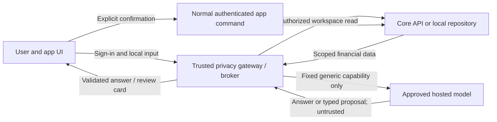

# Agentic financial advisor: delivery and architecture plan

**Status:** Proposed; no code or production changes authorized by this plan  
**Date:** 2026-10-28  
**Product requirements:** [PRD: Shonchoy Financial Chat Advisor](PRD-financial-chat-advisor.md)

> **Superseded privacy boundary:** No user financial data may be sent to a model. The [implementation plan](advisor-implementation-plan.md) replaces the earlier model-bound financial-facts examples below.

## 1. Current state

These observations describe the checked-in workspace and current local changes, not deployed production behavior:

- The mobile `Shonchoy-App-RN` advisor has a chat screen, streaming UI, answer cards, stop/retry and local history. Its default transport calls a deterministic local advisor over the local snapshot. The HTTP transport is available but is not the default; see `src/features/advisor/README.md` in the mobile repository.
- `src/core/sync/default-repository.ts` in the mobile app uses `LocalFinanceRepository` for the standalone synthetic prototype. A connected client exists, but a production advisor must not assume the current screen reads a live backend workspace.
- [`fintrack_advisor`](../src/fintrack_advisor/main.py) exposes an offline-stub response behind a development key. Its [graph](../src/fintrack_advisor/graph.py) does not call a model or financial tools. Production user authentication, scoped data retrieval, a compatible chat contract and model-provider integration remain to be built.
- The mobile HTTP transport now builds a narrow, consent-gated request. The development-only `/v1/agent/analysis` endpoint accepts that contract and returns a deterministic response. It is not connected to the mobile screen, a hosted model or production user authentication.
- Mobile `context-builder.ts` already avoids several identifiers, but its category names and `pii.ts` regex filter are not a complete privacy boundary. Advisor history is currently stored unencrypted and not cleared on sign-out; hardening and migration are required before a hosted pilot.
- The repository's existing invariant is authoritative: the advisor has no financial write authority. App commands use existing workspace authorization, idempotency and version controls. Money is stored and calculated as integer minor units.

## 2. Product and trust boundaries

**Desired capability:** the advisor can help with every supported app area over time, including answering questions, opening the right screen and preparing changes. Each area needs an explicit capability definition; the model never receives a general-purpose app, shell, SQL, browser or network tool.

**Hosted-model decision:** use a provider only after an explicit security and data-processing review. Do not select a vendor or model in code until that review is complete. Compare hosted options for contractual training use, retention including abuse monitoring, subprocessors, residency, logging, deletion, availability and cost. A request flag alone must not be treated as a retention guarantee.



The gateway may handle identity and finances inside the trusted app boundary to authorize a user and resolve records. It must not put identity into a model request. Client authentication headers, cookies and device network identifiers terminate at the app's trusted service; only the service's provider credentials and non-user-correlatable request metadata reach the provider. The model has no database credentials and no mutation endpoint. The app, not the advisor, executes an approved command. This boundary also limits prompt-injection and excessive-agency risks. [OWASP: prompt injection](https://genai.owasp.org/llmrisk/llm01-prompt-injection/), [OWASP: excessive agency](https://genai.owasp.org/llmrisk/llm062025-excessive-agency/).

## 3. Privacy and data flow

### 3.1 Input contract

1. Authenticate the user and establish workspace scope in the trusted app/core boundary. For a connected deployment, replace the advisor's development key as the user-authentication mechanism with the existing managed-auth/session model. Derive workspace identity server-side; never accept it from the model.
2. Resolve the question locally or in the trusted gateway into a typed, allowlisted intent and approved slots. The initial hosted release does **not** send raw user messages, prior chat text, notes, OCR, merchant names, custom labels or category names. Use controlled category/operation codes and validated numeric/date values. If a request cannot be safely represented, ask for clarification or use a local answer; do not send the raw request as a fallback. Support English and Bangla only to the extent the local parser can safely map them; ask when it cannot.
3. Retrieve only the current workspace's data needed for that intent. Calculate aggregates, balances and forecasts in deterministic code. Exclude other tenants and unnecessary records. Financial facts, category labels and free-form text must never enter model requests through tool results, errors, retries, summaries, history, embeddings, attachments or traces.
4. The model-bound payload contains only fixed generic prompts selected from an allowlist. It contains no user amounts, dates, account or category names, identifiers, credentials or cookies. Do not give the model an external browser, a retrieval corpus of raw records or a cross-session memory.
5. Resolve all record references inside the trusted app boundary. Never send record aliases or their mapping to the provider.
6. Apply the same validator to every model-bound turn and tool result, including retries. Do not forward raw HTTP errors, stack traces or provider debug payloads. Disable payload logging and tracing by default in the app, gateway, provider tooling and error reporting. Separate limited, access-controlled security audit metadata from chat/financial content; set retention and deletion policy before release.

**Example generic request to the trusted relay:**

```json
{
  "capability": "spending",
  "consent": true
}
```

The provider receives a fixed generic prompt derived from the capability, not the request body, financial facts, original sentence, account owner, user ID, transaction descriptions or mapping table. The trusted app can display locally calculated results and supporting records.

**Limit of this control:** A unique combination of financial amounts, timing and categories can be re-identified or inferred, so none of those facts are sent to the model. [NIST: de-identification](https://csrc.nist.gov/pubs/ir/8053/final).

### 3.2 Consent, memory and operations

- Before a hosted request, explain that only a generic capability is sent, show the chosen provider and applicable retention, and require opt-in. Allow opt-out and fall back to the existing local advisor where supported. Stop, cancel and retry must not bypass the privacy gateway.
- Keep raw user-visible chat history separate from provider context. Define user-visible retention, delete and export behavior. Before pilot, encrypt persisted history where supported, scope it to the correct user/workspace, and remove it on sign-out or account deletion according to the approved policy, including pending writes and caches. Provider-side retention and deletion depend on the approved provider's actual contract and configuration.
- Use TLS, least-privilege service credentials, rate and token budgets, short-lived aliases and no live financial payloads in telemetry. Trace only random request IDs, capability, status, duration and resource usage; keep any necessary authenticated security audit in a separately protected system. Test crash reports, SDK logs, proxies, request headers and observability exporters for leaks.
- Roll out behind a server-side kill switch. If authorization, transformation, schema validation, provider policy or data freshness fails, return a clear error or local-only answer; never fall back to raw data.

## 4. App-wide capability map

All financial changes below require a validated proposal, a human-readable preview and explicit user confirmation. Availability is gated by the actual repository/backend and policy, not by what the model claims it can do.

| Area | Read / navigate | Proposed actions after confirmation | Delivery notes |
| --- | --- | --- | --- |
| Home and reports | Spending, income, cash flow, net worth, trends and drill-down. | None needed for a report. | Start with deterministic existing calculations and source timestamps. |
| Transactions and transfers | Filter/summarize transactions by approved category, period or account alias. | Draft a transaction, edit or recategorize a record, review, split, hide, delete/restore or record an internal transfer. | Phase in separately; preserve ledger invariants, versions and balanced transfer legs. A bookkeeping transfer is not a bank payment. |
| Budgets and categories | Planned versus spent, remaining amount and category breakdown. | Draft a budget, change a limit, add or edit a category. | First action pilot: one budget line with exact before/after and currency. |
| Accounts | Explain balances and open an account view. | Draft account setup, edit metadata, reconcile or archive/restore where supported. | Sensitive identifiers remain outside model context; require fresh balances/versions. |
| Recurring items and rules | Explain upcoming items and rule effects. | Draft or change a series; create or apply a rule after showing its effect. | Preview bulk impact; do not imply that disabling a reminder cancels an external subscription. |
| People and loans | Show local summaries without identifying people to the model. | Prepare a private loan or repayment only when supported by the existing person and debt rules. | Preserve the current block on loans for linked Shonchoy accounts; no shared agreement or notification is implied. The current People data is local, so connected support needs a separate design. |
| Receipts and SMS | Navigate to capture/review; summarize validated financial fields. | Prepare a transaction from user-reviewed local extraction. | Do not send raw images, SMS, merchant text or OCR to the hosted model. |
| Settings and security | Explain and navigate to settings. | Prepare supported preference changes. | Identity changes, account deletion, data export, sign-in or credentials require dedicated native flows and are outside the initial agentic release. |
| External actions | Explain what the app supports. | None in this plan. | Real payments, messages, third-party cancellation and shared loans require separate integrations, authorization and product approval. |

## 5. Proposal and execution contract

1. Action selection and parameter parsing happen in trusted app code; generic model output never supplies a financial action, target or parameters. Reject free-form URLs, executable code, unknown operations, unsupported currencies and invalid numbers. Missing or ambiguous targets produce a clarification, not a guessed command.
2. Resolve targets in the authenticated user's workspace. Validate permissions, current entity state, version and business rules. Create a canonical proposal containing action type, resolved app-side target, expected versions, integer amount/currency, period, consequences and expiry. The app renders its review card from this canonical data, not from model-written claims.
3. For a change such as “set my Food budget to ৳10,000,” show the existing value, proposed value, period and impact. Allow editing or canceling. Any edit or data change invalidates the old preview and requires a fresh one.
4. On a deliberate **Confirm** action, the authenticated client invokes the normal core/local command path. For connected execution, bind approval to the canonical proposal digest, actor, workspace, target versions and expiry using a server-verifiable receipt or equivalent; reject altered, expired or cross-workspace approvals. The core enforces permissions and business rules again. Use `Idempotency-Key` for retries and `If-Match`/expected version for updates; stale data requires a new review. Never replay a timed-out or uncertain financial action with a new key automatically.
5. Display success only after the command confirms its durable result. On failure, preserve a recoverable draft and show the reason without leaking identity to the model. For multi-step or bulk changes, preview each effect and use atomic domain commands where supported; otherwise explain partial completion and require separate approval rather than claiming all-or-nothing execution.

## 6. Accuracy and user experience

- Produce financial facts in trusted deterministic code, including totals, signs, balance effects and minor-unit conversions. Never let an LLM perform the authoritative calculation or fabricate a transaction. Format monetary values locally.
- Scope results by currency, timezone and period, and report exclusions, missing records and last refresh. Compare like with like; do not combine currencies without a separately approved conversion source and timestamp. Forecasts show assumptions and uncertainty.
- Bind each numeric claim to a validated fact or calculation; verify structured output before rendering. If the model output conflicts with computed facts, refuse or regenerate within a bounded retry budget. Do not treat an LLM self-assessment as verification.
- Provide action cards and links to the underlying records after safe alias resolution. Show an explicit “AI-generated” indication, opt-in status, local fallback and reasons for asking a clarifying question. Respect the existing amount-privacy display setting.
- Avoid unsupported individualized investment, legal or tax claims; if a question needs professional judgment or unavailable information, say what is missing and direct the user to appropriate help. No invented assurances about future balances or repayment.

## 7. Delivery sequence and gates

**0 — Inventory and foundation.** Agree on the first intent/action registry, data dictionary, provider approval and review owner. Design the on-device-to-connected boundary and versioned API contract. Replace the stub's development-key-only access for any real-user pilot. Implement the gateway and synthetic test harness before connecting a provider. Gate: payload and authorization tests pass; no real data in model calls.

**1 — Read-only pilot.** Implement spending, income, budget, cash-flow and net-worth facts, sources and safe answer rendering; connect the existing chat UI through the gateway. Provide local fallback and consent. Gate: approved provider terms; zero seeded identity leaks in synthetic captures; cross-tenant isolation; evaluated numeric correctness and usable latency/cost.

**2 — First proposals.** Add budget-line change and a transaction draft, then review/edit/confirm UI and core approval binding. Gate: no unapproved writes, correct preview, explicit approval, same-key retries, stale-state rejection, workspace isolation and preserved integer-money/ledger rules.

**3 — Broader app actions.** Add each row of the capability map independently, prioritizing account/recurring/rules and then additional features. Each registration requires a data contract, permission model, preview, domain tests, monitoring and rollback. Keep external payments and shared agreements out until separately designed.

**4 — Scale and maintain.** Expand language and intent coverage using privacy-reviewed structured parsing; measure actual use, cost and latency. Conduct recurring red-team and provider-policy reviews, and version model prompts, schemas and evaluations. Enable individual capabilities by feature flag, not a blanket “all actions” switch.

No calendar dates are committed. Estimate each stage after the provider, team capacity and first-release scope are selected.

## 8. Implementation work packages

The paths below identify starting points, not completed work. The mobile paths refer to the separate `Shonchoy-App-RN` repository.

| Package | Starting point and deliverable | Depends on / completion evidence |
| --- | --- | --- |
| Privacy contract | Add versioned typed intent, fact and alias schemas to the trusted backend; reject all unregistered fields and operations. Replace the mobile advisor's raw `message`/`history` transport in `src/features/advisor/models/advisor-transport.ts` with the approved contract. | Synthetic provider capture proves the whole request is allowlisted and contains no seeded identity. |
| Scoped finance facts | Add bounded, read-only aggregates through `fintrack_core` and/or the existing local repository, with currency, period and freshness. Adapt mobile `context-builder.ts` to the same semantics. | Exact integer fixtures and two-workspace isolation pass; local and connected modes are identified explicitly. |
| Hosted model adapter | Extend `src/fintrack_advisor` with an approved stateless provider adapter, authenticated gateway contract, bounded calls, opt-in and kill switch. Never give it write credentials. | Provider terms and configuration are approved; validator failure makes no provider call. |
| Structured output and proposals | Define typed answer/proposal contracts and a registry in the trusted boundary. Resolve aliases there, calculate previews deterministically, and design server-verifiable approval binding in the core command path. | Tampered, ambiguous, expired, replayed and cross-workspace proposals are rejected. |
| Mobile experience | Extend `src/features/advisor/screens/advisor-chat-screen.tsx` and its components with disclosure, clarification, sourced answer cards, preview/edit/confirm/cancel and local fallback. | Accessibility and end-to-end tests show no financial write before confirmation. |
| Chat lifecycle | Update `src/features/advisor/hooks/use-advisor-chat-store.ts` and storage adapters for the approved encryption, retention, deletion and sign-out policy; keep raw chat out of model history. | Session deletion, sign-out, restart, pending writes and different-user tests pass. |
| Capability expansion | Register each later app capability only after its domain data and command handlers exist and have independent tests and a feature flag. | Each row in the capability map has a documented owner, support state, guardrails and rollback. |

## 9. Verification plan

Use synthetic fixtures and intercepted model-provider calls; never use production records for disposable test data. The minimum release suite covers:

- **Privacy:** Seed names in English and Bangla, email, phone, identifiers, labels, notes, OCR text, credentials and adversarial prompts in every input surface. Inspect the complete provider request and relevant headers on initial calls, retries, tool results and history. Assert none of the seeded markers or real IDs appears; test unknown fields, validator failure and provider error paths. Review logs, traces and analytics for the same markers.
- **Isolation:** Two workspaces with overlapping aliases cannot read or approve each other's records; signed approval, session aliases, caches and local history cannot be reused across users, sessions or after expiry/sign-out.
- **Financial correctness:** Verify deterministic totals against known integer fixtures, currencies, negative/zero values, transfers, partial data, time boundaries, freshness and budget periods. Check that every displayed number comes from an allowed fact and that uncertainty is surfaced.
- **Authorization and safety:** Confirm no model/tool call can write, and that decline, interruption or prompt injection creates no mutation. Test confirmation binding, tampering, replay, stale versions, duplicate taps, timeouts, retries and partial failure against existing command semantics.
- **UX and operations:** Exercise consent/opt-out, clarification, offline fallback, stop/retry, screen-reader labels, privacy display, encrypted history lifecycle, feature flags and kill switch. Measure latency/cost on a synthetic workload and collect user feedback without logging financial text.

Release only after the named product/security owners approve the evidence and provider terms. These gates reduce risk; no finite test suite proves that financial data can never be re-identified.
